# Diseño e Implementación de una Infraestructura de Despliegue Continuo con GitOps y ArgoCD en Kubernetes (K8s) sobre una Base No Convencional y un Kernel Optimizado de Baja Latencia

## Indice

---

## Introducción

### Introducción al sistema operativo

Primero comenzaremos por lo más básico, el sistema operativo, la base de la mayoría de proyectos y lo que los definen. Para este proyecto estaremos usando **[Ryoku](https://ryoku.dev)**, una distribución de Linux la cual usa como base Arch Linux, pero a diferencia de este es mucho más sencillo de instalar, al igual que otras alternativas como Omarchy, las cuales facilitan mucho la instalación, configuración y uso de estos sistemas operativos para la gente que no tiene un conocimiento tan elevado de la informática.

Las razones que me han hecho elegir esto frente a otras alternativas como pueden llegar a ser Omarchy, EndeavourOS o directamente, un Arch puro con dotfiles, son principalmente su estética brutalista japonesa, sumada a su perfecta sinergia con varias aplicaciones propias que permiten un excelente manejo del sistema. Entre ellas destacan una herramienta propia para cambiar los fondos de pantalla y adaptar el layout completo al fondo y al tema, un reproductor propio que se integra al tema que estemos usando, un agente integrado que permite que la IA ejecute comandos sobre nuestro sistema según lo que le pidamos, un gestor de máquinas virtuales propio y mucho más.

### Introducción al kernel

Ahora que hemos introducido nuestro sistema operativo, toca intrducir el kernel, el cual tambien es muy importante, sobre todo en nuestro proyecto en el cual no queremos solo usarlo sino también demostrar porque es mejor este kernel ultramodificado para tener mejor rendimiento que un kernel convencional.

El kerner que usaremos será el del sistema operativo **[Cachyos](https://cachyos.org/)**, lo que tiene de especial es que es un sistema operativo mayormente dedicado para exprimir al máximo los recursos de cualquier pc que sea decente, esto mayormente suele usarse para gaming pero para este proyecto le daremos otro uso.

Ya que vamos a estar hablando todo el rato de esto, antes de seguir vamos a explicar lo que es un kernel de baja latencia, la latencia es el tiempo de espera entre la orden y su respuesta, por lo que el kernel de baja latencia lo que tiene de novedoso es reduce el scheduler para que cuando llegue una tarea la ejecute de inmediato aunque haya otras en marcha, esto lo explicaremos con más detalle más adelante

### Introducción a kubernetes

Ahora toca el momento de introducir otra herrramienta muy importante en nuestro proyecto como es el caso de kubernete, tambien conocido como k86, kunernetes es la herramienta que se encarga de automatizar tanto el despliegue como la escalabilidad y la gestión de aplicaciones en contenedores.

Kubernetes tiene cosas muy buenas como pueden ser el reinicio de los nodos que fallen sustituyendolos por otros que funcionen bien y reprogramandolos (self reparing), la agrupacion de servidores, ya sean fisicos o virtuales en un solo gurpo organizado, la escalabilidad automatizable y el balanceo de carga asi como el gestor de secretos son una de las muchas cosas que tiene esta herramienta

### Introduccion a GitOps

Gitops una metodologia de trabajo que usa GitHub como fuente central, unas de sus ventajas son:

1. Historial y auditoría total: Si el sistema falla, puedes revisar el historial de Git para ver qué cambio causó el problema.
2. Recuperación ante desastres (Rollback inmediato): Si una actualización rompe el sistema, simplemente regresas a la versión anterior en Git (commit anterior) y la herramienta GitOps reparará el clúster en segundos.
3. Mayor seguridad: Los desarrolladores no necesitan accesos directos ni contraseñas de los servidores de producción; solo necesitan permiso para proponer cambios en Git.

### Introducción a ArgoCD

Y llegamos a la ultima pieza de nuestro proyecto, argocd, la cual se encarga de unir Github y Kubernetes haciendo una sinergia perfecta.

Su trabajo consiste en leer la estructura que tiene descrita en nuestro repositorio GitHub y compararlo con lo que realmente esta bcorriendo en kubernetes, así mismo realizando cambios si fuese necesario. Si un desarrollador sube una nueva versión a Github, ArgoCD lo detecta inmediatamente y actualiza el cluster. Y si alguien por error intenta modificar algo a mano en kubernetes argocd lo corrige al instante.

## Instalacion del sistema operativo

Para instalar ryoku tenemos varias bases entre las cuales se encuentran: arch y cachyos comos bases estables y en version aun experimentales podemos encontrar void linux, fedora y nixos. Nosotros usaremos cachyos como base ya que haremos uso del kernel de baja latencia que nos proporciona cachyos para buestro proyecto asi como algunas de sus mejoras frete a arch linux.

Lo primero que haremos sera intalar ryoku desde su pagina web seleccionando la opcion de cachyos **[Ryoku](https://ryoku.dev)**

Ahora procederemos a explicar su instalacion:

0. Al iniciar la maquina vemos lo sigiuiente que basicamente nos dices que gracias por instalar la iso y que esta no es una live version que es cuando tu puedes probar una iso sin escribir en el disco duro, como si fuera de prueba.

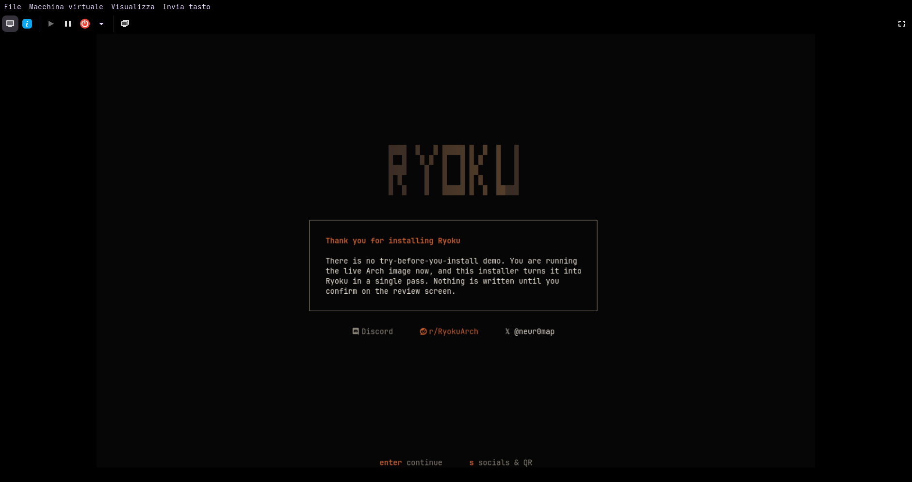

1. Ahora nos sale una pantalla para seleccionar el layout del teclado, yo lo dejare en US ya que el teclado que estoy usando es con la distribucion de teclas US.

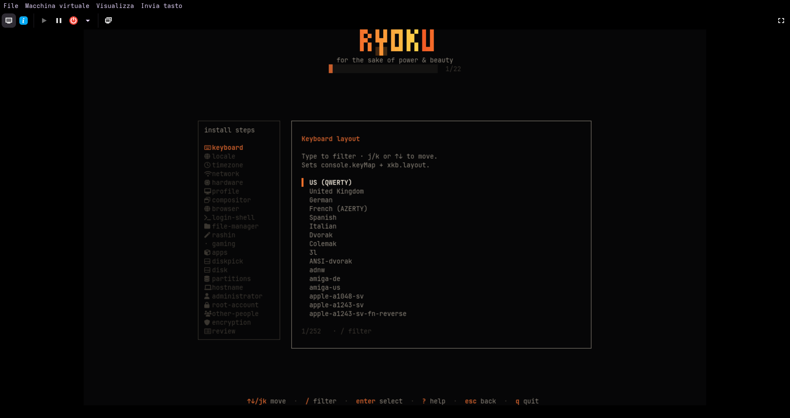

2. Depues toca la seleccion de locales, los cuales dejare en español.

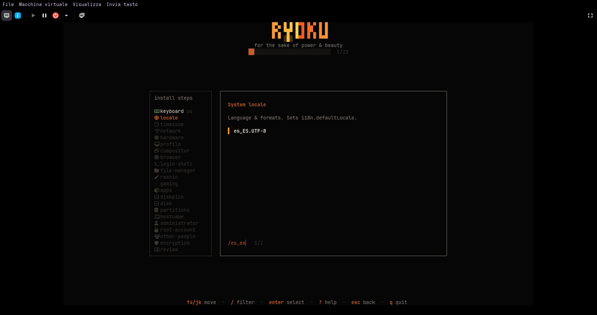

3. Ahora viene la parte de la timezone que yo la dejare en que la pille automaticamente en funcion a nuestra ubicacion.

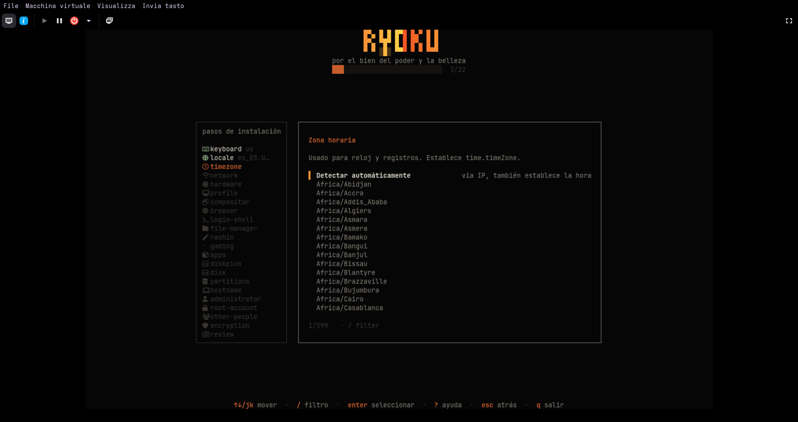

4. En esta parte nos sale la parte de red, pero como es una iso completa en la cual no necesitamos tener que acceder a internet para instalar absolutamente nada por lo cual para lo unico que sirv es para informarnos.

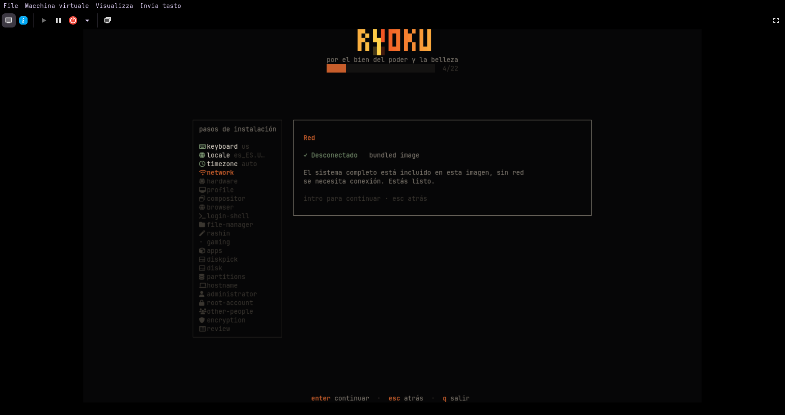

5. La parte que viene ahora es bastante peculiar, pocas isos tienen esto y es el hecho de que te detecte el hardware de tu dispositivo y te recomiende un paquetes de herramientas dependiendo de que estes usando para que le puedas sacar el maximo jugo posible al sistema operativo, habiendo 4 opciones, una para amd puro, uno para intel puro, uno para nvidia que es para gpu nvidia pero si no tienes todo nvidia sino que tienes una gpu amd tambien te ssirve y una poara maquinas virtuales.

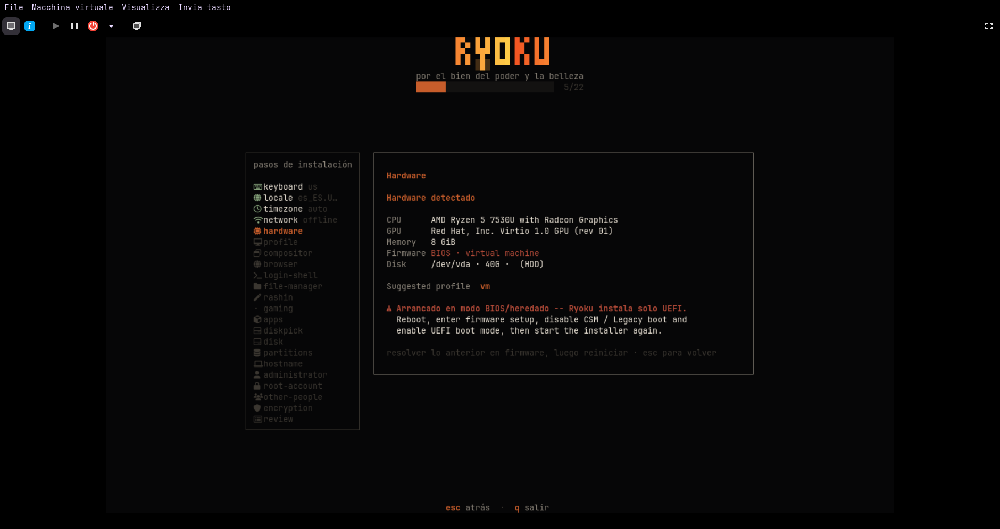

6. Ahorea te deja seleccionar, puedes elegir la que quioeras pero lo mejor es elegir la que te estan recomendando ya que es la que mas te va a servir para no tener problemas a futuro con el hardware

7. Ahora toca elegir el compositor, tenemos tre opciones, hyperland, niri y Wayfire, en este caso usaremos niri ya que es con el que me siento mas familiarizados, el resto no los he probado por lo que tampoco puedo explicar las diferenciasd de cada uno o si unos es mejor o peor que otro en x cosa pero bajo mi experiencia personal abundan mucho los atajos de teclado y al ser tiling manager as ventanas no se superponen entre si sino que se van reagrupando en forma de mosaico.

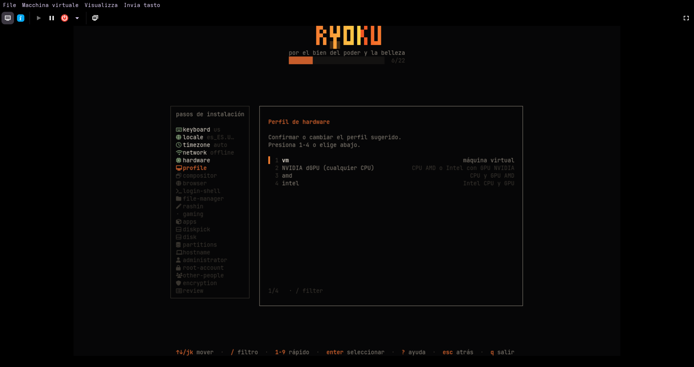

8. Ahora nos toca la parte de elegir nuestro navegador principal, tenemos cuatro opciones en las cxuales se encuentran: firefox, zen browser, chromium o no instalar ninguno, en mi caso elegire zen browser ya que es con el que estoy mas familiarizado.

9. Ahora nos pide elegir una shell para la terminal, elegir tres opciones, fish zsh o fish, yo elegire fish.

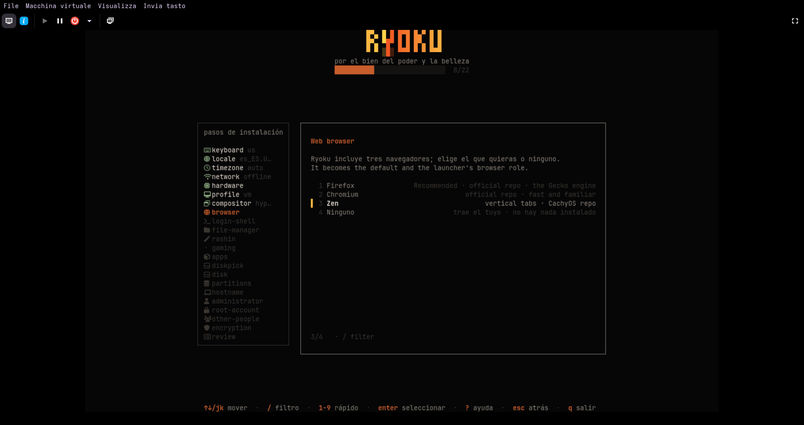

10. tras elegir el shell nos toca elegir el gestor de archivos, yo elegire nautilus, el de genome por su estestica.

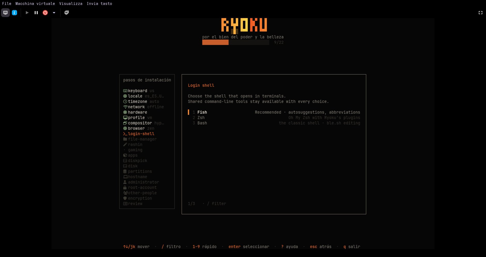

11. Ahora nos da la opcion de elegir si queremos usar o no rashin que es la ia local que puede ejecutar comandos en nuestra maquina en funcion de lo que le pidamos. Usando hermes que es suagente que a su vez puede integrarse con otras inteligencias artificiales.

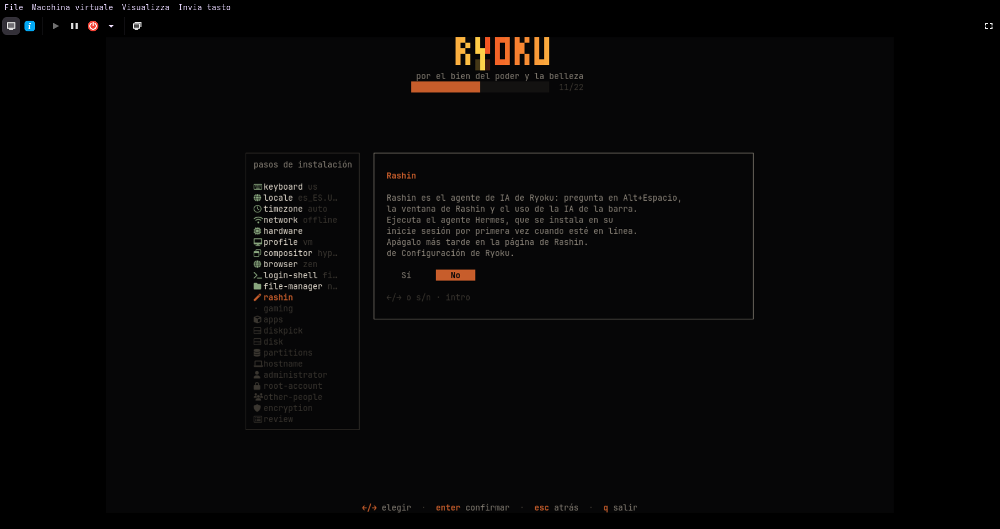

12. Aqui nos da la opcion de instalar los paquetes de optimizacion para nuestro sistema operativo, pero como nosostros hemos decidido instalar la version que usa cachyos como base ya lo tenemos integrado por defecto.

13. Ahora sale la parte de herramientas por si queremosquitar alguna de las que salen, yo las dejare todas.

14. En la siguiente ventana nos toca seleccionar el disco en el cual vamos a instalar el sistema operativo.

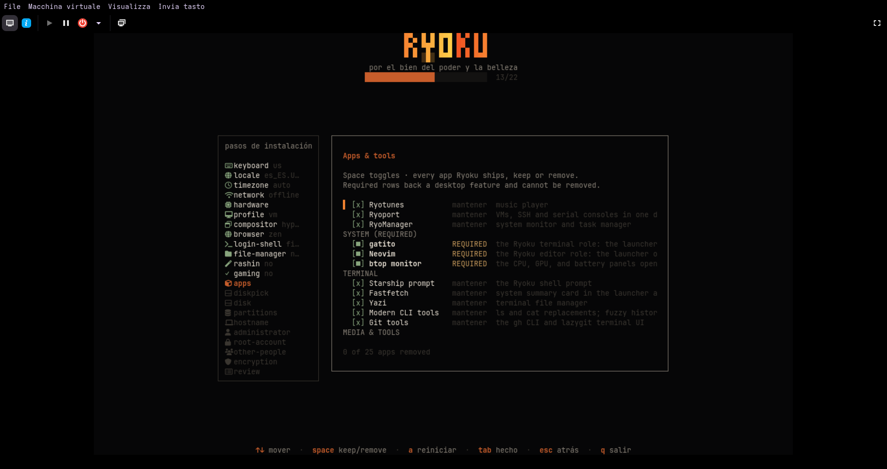

15. En lo siguiente estaria para si queremos un dual boot o usar todo el disco pero como es una maquina virtual usaremos todo el disco.

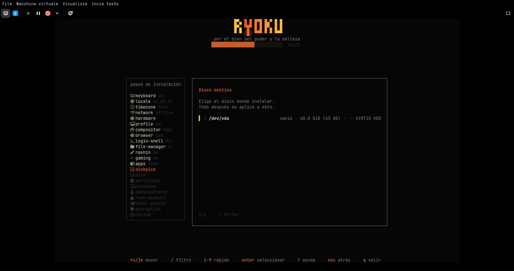

16. En la parte de particiones reservaremos 4gb para la bios, quitaremos la swap, y lo de las snapshots, tambien quitaremos lo del home separad y los respaldos ya que no son necesarios.

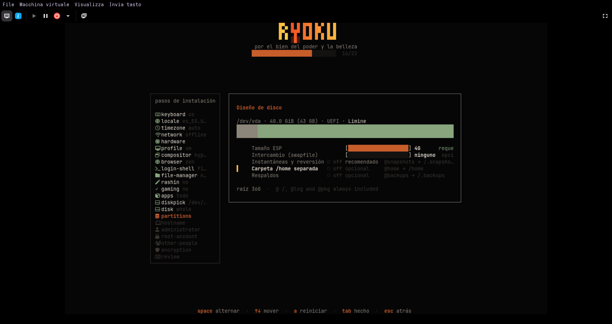

17. De hostame dejaremos ql que viene por defecto.

18. Ahora creamos la cueta de usuario que administrara esta maquina virtual.

19. En los permisos poemos que se tenga que usar sudo para hacer cambios e el sistema y que no sea una contraseña distinta entre la de root y la de sudo.

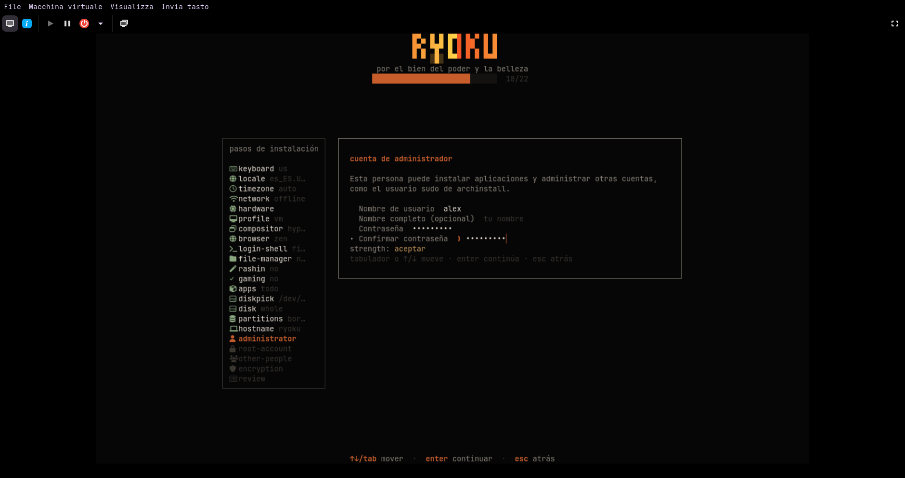

20. Nos da la opcion de crear un segundo usuario pero con uno solo es suficiente.

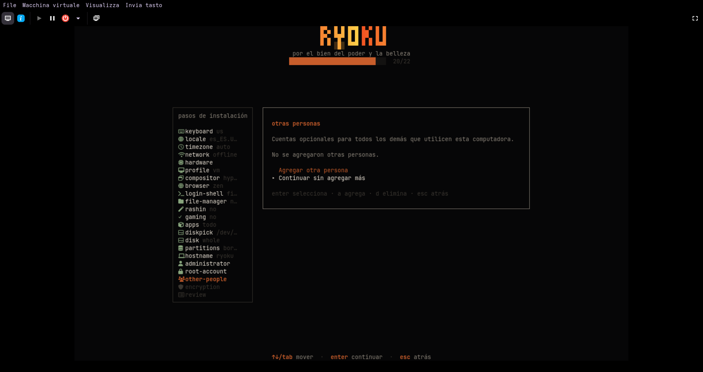

21. Ahora nos da la opcion de que el root quede encriptado co luks pero yo no lo veo necesario asi que seleccionaremos no.

22. Al terminar vemos todo lo que hemos seleccionado y le damos a que si para que empiece.

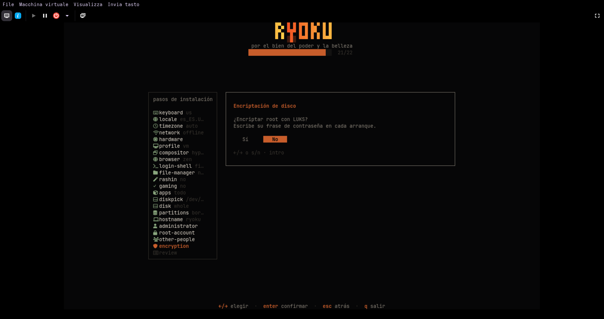

23. Asi es como se ve mientras seesta instalando el sistema operativo

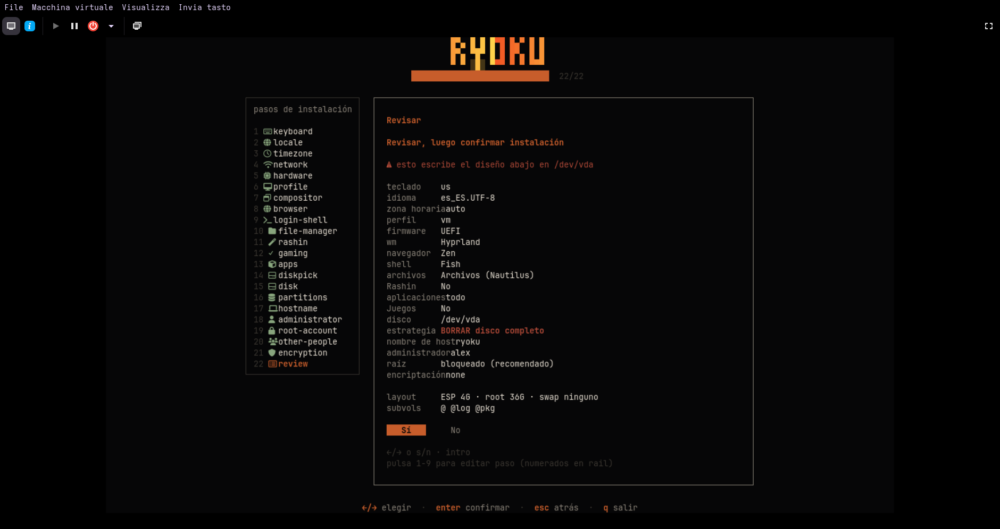

24. Al terminar de instalar el sistema operativo le damos a que se reinicie.

25. Al entrar vemos esta pestaña de login la cual se podria cambiar en la store que tiene integrada el sistema operativo

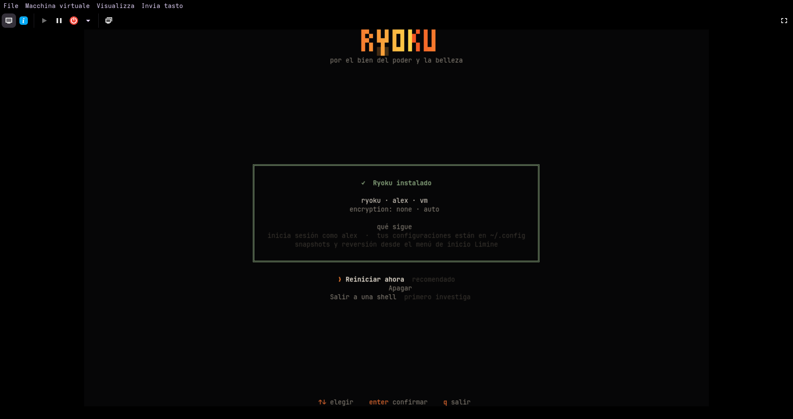

26. Al iniciar siempre nos sale esto de loading desktop.

27. Al iniciar esto por primera vez nos sale un breve mensaje de bienvenida.

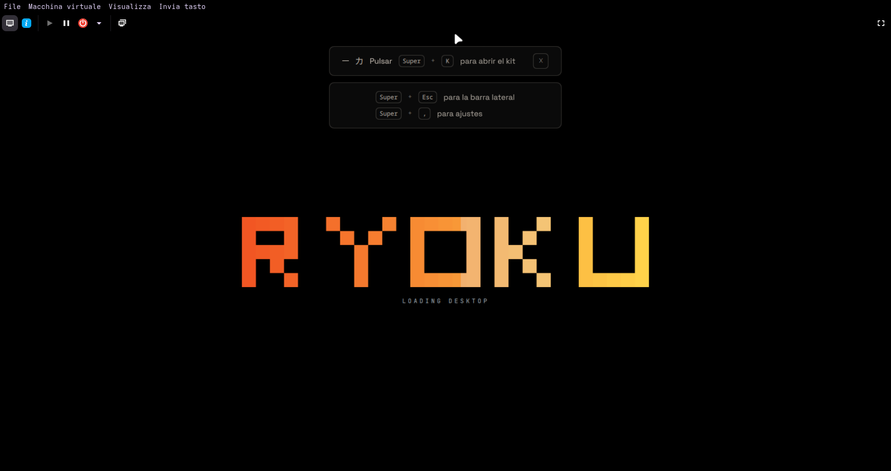

28. Nos da la eleccion de cambiar la barra superior pero por ahora yo dejare la que esta por defecto.

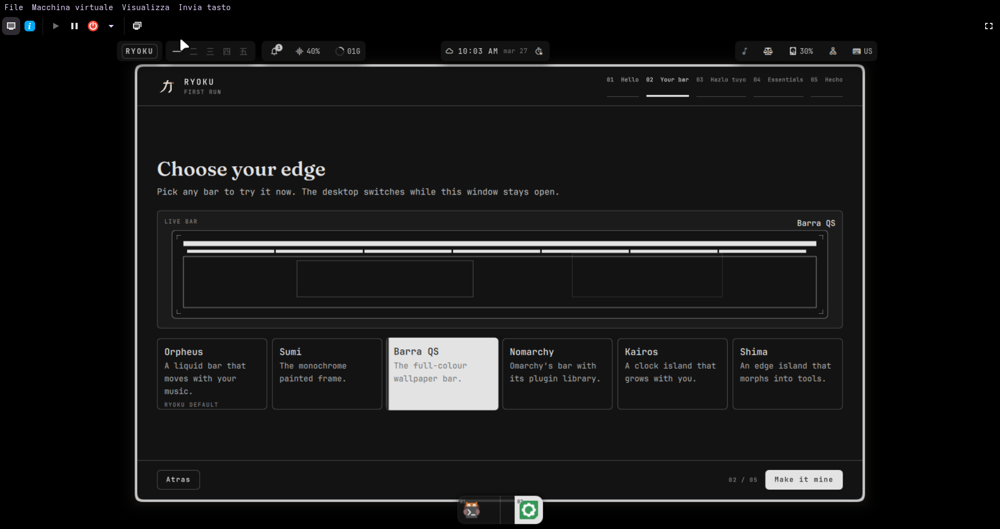

29. No da la opcion d epersonalizarlo a nuestro gusto pero lo dejaremos como viene por defecto.

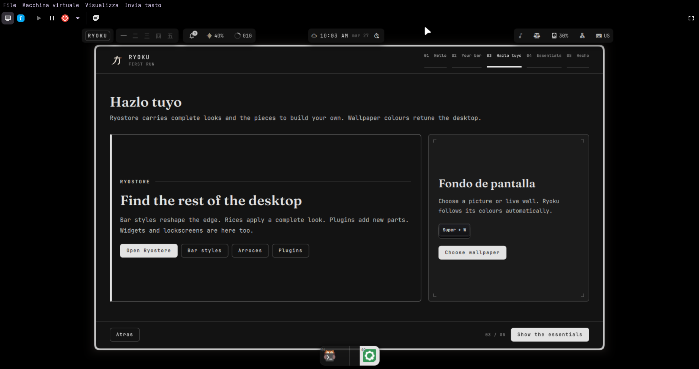

30. Nos muestran todos los atajos de teclado que son muy importantes en esta interfaz grafica que estamos usando ya que facilita mucho saberse los atajos de teclado.

31. Y tras esto acabamos la configuracion de bienvenida.

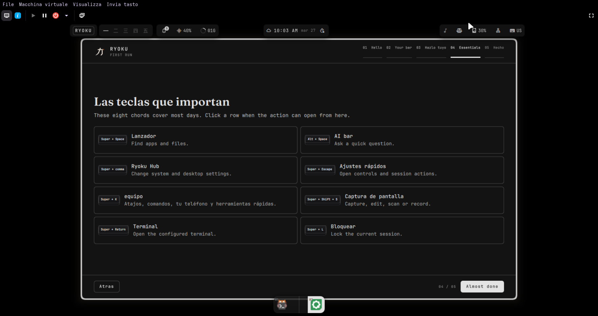

32. Asi es como se ve nuestro sistema operativo sin ninguna personalizacion.

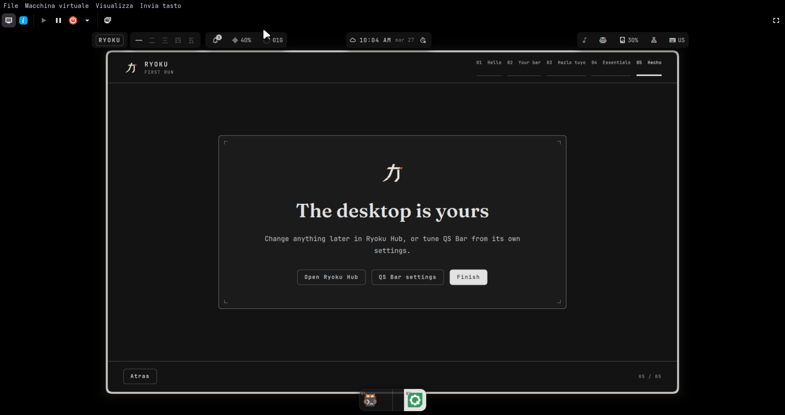

33. Y tras la personalizacion nos quedaria de la siguiente forma, como se puede ver dista bastate del anterior, y eso es gracias a la enorme personalizacion que tiene esto sistema operativo

